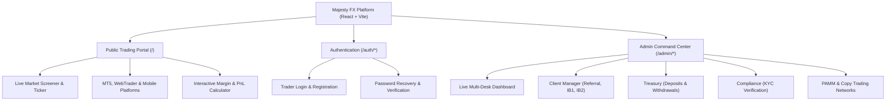
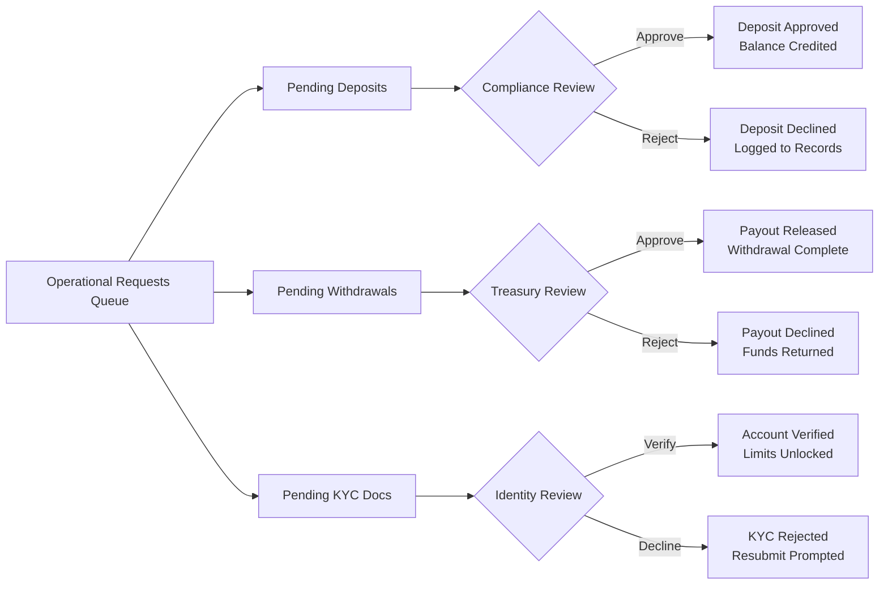
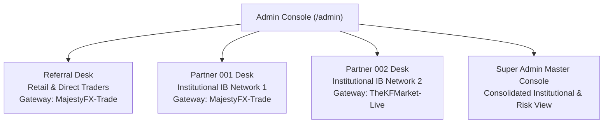
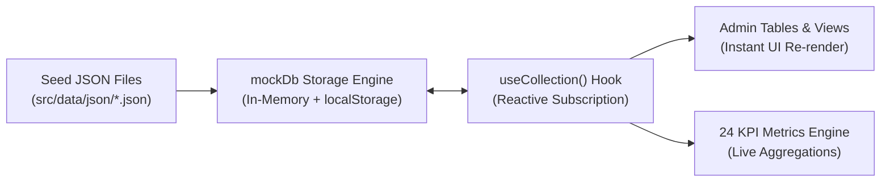

# Majesty FX — Institutional Trading Platform & Admin Console

A high-performance trading platform frontend built with **React**, **Vite**, and **Tailwind CSS**. It includes a modern retail trading landing platform and an institutional-grade administrative suite with reactive client management, multi-desk routing, operational queues, and 24 live KPI metrics.

---

## High-Level Architecture & Structure



---

## Directory Structure

```
Majesty fx/
├── public/                       # Static public assets (favicons, icons)
├── src/
│   ├── assets/                   # Market images, platform graphics & logos
│   ├── components/               # Reusable UI component modules
│   │   ├── admin/                # Admin layout, protection, tables, and dialogs
│   │   │   ├── AdminLayout.jsx   # Responsive sidebar & navigation shell
│   │   │   ├── AdminProtected.jsx# Route protection & session guard
│   │   │   ├── ConfirmDialog.jsx # Reusable action confirmation modal
│   │   │   ├── RowActions.jsx    # Table inline action buttons (edit/delete)
│   │   │   └── TablePager.jsx    # Standard table pagination & row counter
│   │   ├── route/                # Authentication layout & language switcher
│   │   ├── Hero.jsx              # Landing hero banner with phone mockup
│   │   ├── Instruments.jsx       # Real-time multi-asset market screener
│   │   ├── Accounts.jsx          # Account tier cards & interactive calculator
│   │   ├── Platforms.jsx         # MetaTrader 5, WebTrader & mobile showcase
│   │   └── Reviews.jsx           # High-speed bidirectional review marquees
│   ├── data/
│   │   ├── json/                 # 50+ JSON seed datasets for admin collections
│   │   ├── collections.js        # Registry of all reactive database collections
│   │   └── data.js               # Static content, pricing feeds & navigation links
│   ├── hooks/
│   │   ├── useCollection.js      # Reactive CRUD hook with cross-tab persistence
│   │   └── useTableControls.js   # Search, filter, sorting & pagination controller
│   ├── pages/
│   │   ├── admin/                # 50+ dedicated institutional admin pages
│   │   │   ├── AdminDemo.jsx     # Master /admin dashboard (KPIs & queues)
│   │   │   ├── AdminClients.jsx  # Client manager with modals & floating actions
│   │   │   ├── AdminKYCDocuments.jsx # KYC identity verification portal
│   │   │   ├── AdminDepositHistory.jsx # Deposit ledger & review
│   │   │   └── AdminWithdrawHistory.jsx# Withdrawal payout processing
│   │   └── ...                   # Public routes & authentication screens
│   ├── services/
│   │   └── mockDb.js             # Reactive in-memory DB backed by localStorage
│   ├── styles/
│   │   ├── admin.css             # Institutional admin styles & KPI card tokens
│   │   └── index.css             # Base Tailwind directives & typography
│   ├── utils/
│   │   ├── adminAuth.js          # Admin credentials & session management
│   │   └── dashboardMetrics.js   # Real-time math engine for 24 KPI metrics
│   ├── App.jsx                   # Master routing table & layout composition
│   └── main.jsx                  # React application entry point
├── package.json                  # NPM dependencies & build scripts
├── tailwind.config.js            # Tailwind typography, theme & color palette
├── vite.config.js                # Vite bundler plugins & dev server config
└── README.md                     # Project documentation
```

---

## Operational Workflows

### 1. Deposit & Payout Queue Workflow

The operational queue flags all incoming transactions requiring administrative compliance approval, treasury release, or KYC document verification:



---

### 2. Multi-Desk Architecture

The administrative portal supports four isolated execution desks, each configured with dedicated MT5 gateway mappings, client routing rules, and color badges:



---

### 3. Reactive Data Flow Engine

All administrative interactions update instantly across screens without page reloads using a centralized reactive event bus and `localStorage` caching:



---

## Running the Project

### Prerequisites
- **Node.js** (v18.0 or higher recommended)
- **npm** (v9.0 or higher)

### Quick Start (Windows)
Double-click `launch.bat` in the root folder. It checks for Node.js, installs dependencies if needed, and starts the development server.

### Manual Commands

```bash
# 1. Install dependencies
npm install

# 2. Run local development server
npm run dev

# 3. Build for production
npm run build

# 4. Preview production build locally
npm run preview
```

---

## Key Admin Features

| Feature | Description |
| :--- | :--- |
| **Operational Queue** | Top alert card indicating items requiring compliance or treasury action. |
| **24 KPI Cards** | Live metric calculations for deposits, withdrawals, equity, credit, clients, and trading accounts. |
| **Client Management** | Multi-tiered filtering (`Referral`, `IB1`, `IB2`, `Demo`), status toggling, and detail inspection modals. |
| **Treasury & Finance** | One-click deposit approval, payout processing, and internal transfer tracking. |
| **Compliance & KYC** | Secure proof-of-payment review and document identity verification. |
| **PAMM & Copy Trading** | Master accounts, follower allocations, and profit-sharing commission settlement. |
